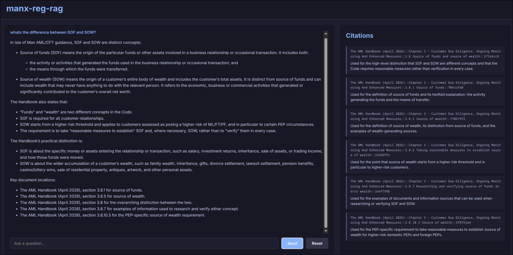
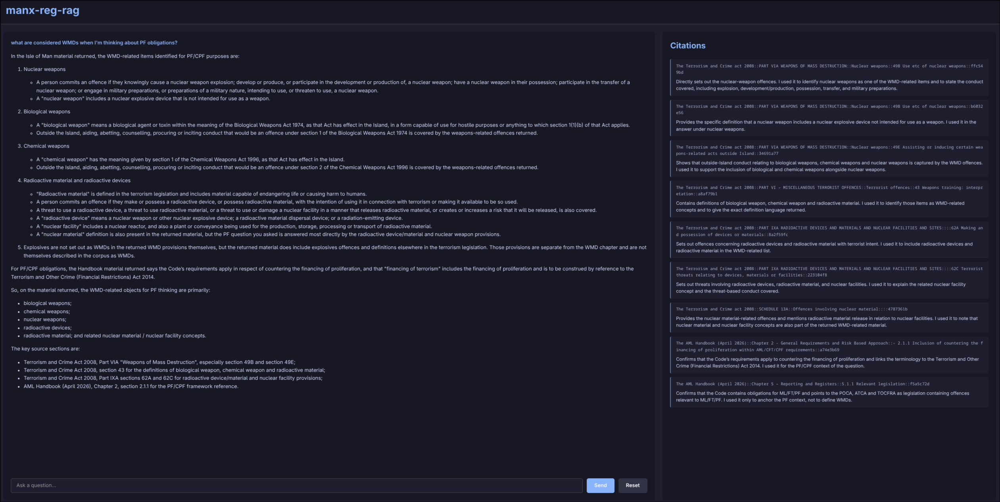
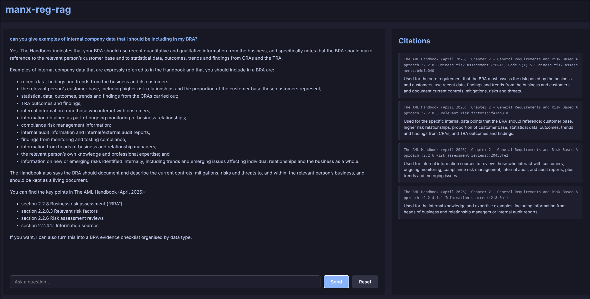
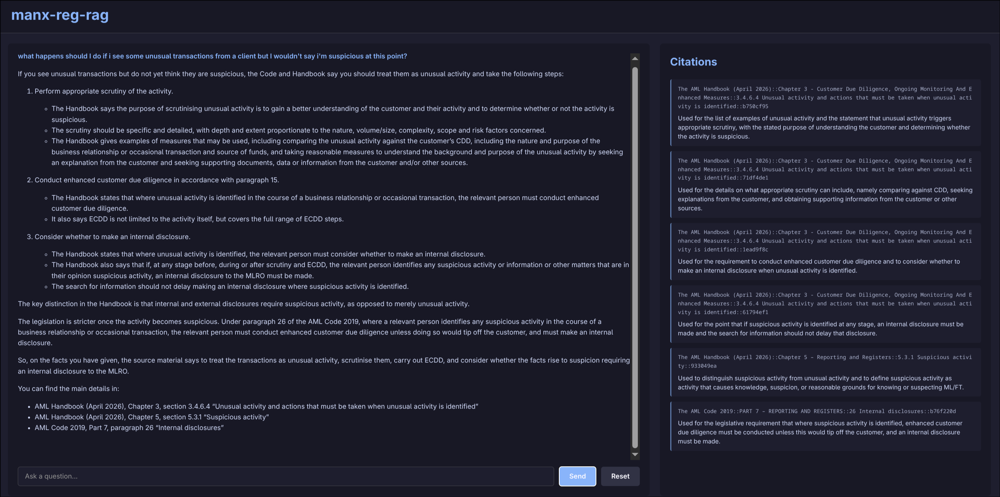
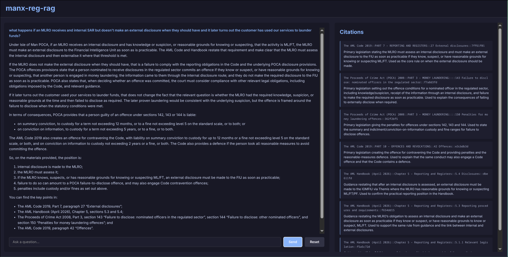

# manx-reg-rag

A question-and-answer tool for Isle of Man Licence Holders and Designated Businesses. Make any AI an expert in Isle of Man financial services legislation and regulation.

## What this is

manx-reg-rag answers compliance questions using the actual text of Isle of Man financial services legislation and guidance — not general knowledge. Ask it something in plain English, and it tells you what the source material actually says, and exactly which document and section the answer came from.

I'm a compliance professional, not a developer, and this is my first real attempt at building something like this. It's a genuine work in progress — see [Limitations](#limitations) before relying on anything it tells you.

## Why I built this

**The problem.** AI tools are trained on huge amounts of text, and that's where their "knowledge" comes from. Where the training data is thin, so is the understanding. Isle of Man financial services regulation is a small, specific field sitting inside a much bigger pool of UK and international material. Most IOM compliance practitioners will already have noticed that general-purpose AI, asked about IOM-specific requirements, tends to answer with UK law instead — because there's far more UK material to draw on — or, with weaker tools, simply makes something up.

**The solution.** The reliable way to give an AI knowledge it doesn't have is to hand it the actual source text at the moment you ask the question, and have it answer from that alone — a technique usually called Retrieval Augmented Generation, or RAG. It's not new technology, but as far as I know this is the first time it's been made available for Isle of Man regulation in an open, free format — free from me, at least. You'll still need to bring your own AI model, and if you're using a paid one, that cost is yours.

## How it works

Every answer is built from the actual text of Isle of Man legislation and guidance, retrieved fresh for each question — not from the AI's memory.

**Getting the documents ready.** Each source document is converted to text and broken into chunks — roughly section-sized pieces — along with exactly where in the document each piece sits (which Part, which paragraph) and which document it came from.

**Definitions.** Legal text is full of defined terms, and a chunk that uses one without its definition can be misleading on its own. So every defined term in each document is captured separately, and whenever a chunk uses one of those terms, its definition is pulled in alongside it automatically.

**Finding the right chunks.** All of this is stored in what's called a vector database. If that means nothing to you, you don't need it to — a rough picture: imagine a library where passages are shelved not alphabetically, but by what they're actually about, so chunks discussing similar things end up near each other even if they use completely different words. When you ask a question, it gets placed on that same shelf, and the tool pulls back whatever's sitting closest to it.

**The answer.** The retrieved chunks and their definitions are handed to the AI, which is instructed to answer only from what it's been given — not its own general knowledge — and to say so plainly if the material it retrieved doesn't actually answer your question, rather than guess. It also distinguishes legislation, which you must follow, from guidance, which is persuasive rather than binding. Alongside the answer, it lists exactly which passages it used and how. It's built to point you to the material, not to advise you — the judgement calls stay with you.

## What it covers right now

Right now the tool only has limited material relating to AML/CFT and the Financial Services Act 2008. Thirty-six documents are loaded:

| Document | Hierarchy | Date | Tynwald | Made / issued under |
|---|---|---|---|---|
| The AML/CFT Code 2019 (SD 2019/0202) | Secondary legislation | Made 2 May 2019; in operation 1 June 2019 | Laid before Tynwald 21 May 2019 (annulled only if Tynwald resolves) | Department of Home Affairs, under s.157 Proceeds of Crime Act 2008 and s.68 Terrorism and Other Crime (Financial Restrictions) Act 2014 |
| The AML/CFT Handbook (August 2026) | Guidance | August 2026 | No | Authority, under s.12 Financial Services Act 2008 and s.32 Designated Businesses (Registration and Oversight) Act 2015 |
| The AML/CFT Supplemental Information Document | Supplemental | Version 01, July 2021 | No | None. States it does not have the status of guidance |
| The Proceeds of Crime Act 2008 (AT 13 of 2008) | Primary legislation | Royal Assent 21 October 2008 | Yes, Act of Tynwald | – |
| The Financial Intelligence Unit Act 2016 (AT 5 of 2016) | Primary legislation | Royal Assent 19 April 2016 | Yes, Act of Tynwald | – |
| AML/CFT (Civil Penalties) Regulations 2019 (SD 2019/0201) | Secondary legislation | Made 18 June 2019 | Approved by Tynwald 18 June 2019 | Authority, under s.157 Proceeds of Crime Act 2008 and s.68 Terrorism and Other Crime (Financial Restrictions) Act 2014 |
| The Anti-Terrorism and Crime Act 2003 (AT 6 of 2003) | Primary legislation | Royal Assent 20 May 2003 | Yes, Act of Tynwald | – |
| The Regulated Activities Order 2011 (SD 2011/0884) | Secondary legislation | Made 26 October 2011; in operation 1 January 2012 | Approved by Tynwald 13 December 2011 | Treasury, under s.3 Financial Services Act 2008 |
| Terrorism and Other Crime (Financial Restrictions) Act 2014 (AT 13 of 2014) | Primary legislation | Royal Assent 18 November 2014 | Yes, Act of Tynwald | – |
| Designated Businesses (Registration and Oversight) Act 2015 (AT 9 of 2015) | Primary legislation | Royal Assent 16 June 2015 | Yes, Act of Tynwald | – |
| Sanctions Act 2024 (AT 2 of 2024) | Primary legislation | Royal Assent 16 April 2024 | Yes, Act of Tynwald | – |
| The Financial Services Act 2008 (AT 8 of 2008) | Primary legislation | Royal Assent 17 June 2008; commenced 1 August 2008 | Yes, Act of Tynwald | – |
| The Financial Services Rule Book 2016 (SD 2016/0264) | Secondary legislation | Made 7 September 2016; in operation 1 January 2017 | Approved by Tynwald 15 November 2016 | Authority, under s.18 and Schedule 3 Financial Services Act 2008 |
| The Financial Services (Exemptions) Regulations 2011 (SD 2011/0885) | Secondary legislation | Made 4 November 2011; in operation 1 January 2012 | Approved by Tynwald 13 December 2011 | Financial Supervision Commission, under s.44(2) and (3) Financial Services Act 2008 |
| The Financial Services (Civil Penalties) Regulations 2015 (SD 2015/0243) | Secondary legislation | Made 23 June 2015; in operation 1 August 2015 | Approved by Tynwald 22 July 2015 | Financial Supervision Commission, under s.16(5) Financial Services Act 2008 |
| The Insurance Act 2008 (AT 16 of 2008) | Primary legislation | Royal Assent 21 October 2008; commenced 1 December 2008 | Yes, Act of Tynwald | – |
| The Insurance Regulations 2025 (SD 2025/0138) | Secondary legislation | Made 18 June 2025; in operation 30 June 2025 | Laid before Tynwald 21 October 2025 (annulled only if Tynwald resolves) | Authority, under ss.5, 6, 12, 12A, 14, 18, 22, 23, 27A, 48, 50 and 54 of, and Schedule 7 to, the Insurance Act 2008 |
| The Insurance (Civil Penalties) Regulations 2023 (SD 2023/0073) | Secondary legislation | Made 16 February 2023; in operation 1 May 2023 | Laid before Tynwald 25 April 2023 (annulled only if Tynwald resolves) | Authority, under s.50(1) Insurance Act 2008 |
| Guidance on the Financial Services Rule Book 2016 | Guidance | Last updated January 2024 | No | Not stated* |
| Conflicts of Interest Policy - Guidance Note - Rule 8.9 | Guidance | January 2017 | No | Not stated* |
| Business Plan Guidance | Guidance | Version 2, issued 12 September 2025 | No | Authority, under s.12 Financial Services Act 2008 and s.34 Insurance Act 2008 |
| Guidance on Rules 7.3 to 7.8 - Changes in Ownership and Structure | Guidance | August 2018 | No | Not stated* |
| Inspections Guidance for Firms | Guidance | October 2021 | No | Not stated* |
| Guidance on Corporate Governance (all licenceholders except Deposit Takers and Professional Officers) | Guidance | March 2017 | No | Not stated* |
| Regulatory Guidance - Cyber Security | Guidance | First issued 12 December 2016; V.03 issued 27 June 2023 | No | Authority, under s.12 Financial Services Act 2008, s.34 Insurance Act 2008 and s.42 Retirement Benefits Schemes Act 2000 |
| Guidance on Directorships, Trusteeships and similar Responsibilities | Guidance | August 2018 | No | Not stated* |
| Discretionary Civil Penalties under the FSA08 and IA08 - Guidance Note | Guidance | First issued 1 August 2015 (by the FSC); last updated 20 December 2022 | No | Not stated* |
| Guidelines on Expected Practice for Trust Service Providers | Guidance | February 2017 | No | Not stated* |
| Guidance Note - Rule 8.17 - Breaches of Regulatory Requirements | Guidance | September 2019 | No | Not stated* |
| Guidance on Rule 8.16 - Outsourcing and Delegation of Functions | Guidance | Version 2, November 2024 | No | Not stated* |
| Regulatory Guidance - Fitness and Propriety | Guidance | 11 December 2025 | No | Authority, under s.6 and s.12 Financial Services Act 2008, s.34 Insurance Act 2008 and s.42 Retirement Benefits Schemes Act 2000 |
| Guidance on Rule 2.30 and Appendix 3 (Note 4) - Qualifying Subordinated Loans | Guidance | May 2017, updated August 2018 | No | Not stated* |
| Financial Services Rule Book 2016 - Rules relating to record keeping | Guidance | Last updated October 2018 | No | Not stated* |
| Financial Services Rule Book 2016 - Consent and Information Summary Table | Guidance | August 2018 | No | Not stated* |
| Financial Services Rule Book 2016 - Obligations to keep registers | Guidance | January 2017 | No | Not stated* |
| Financial Services Rule Book 2016 - Rules relating to policies | Guidance | January 2017 | No | Not stated* |

Dates for legislation are when it was enacted or made. The versions loaded are consolidated, so they include later amendments.

More more documents are planned but its a work in progress. For now, you'll find the docs heavily weighted towards FSA08 and associated guidance as well as AML/CFT documents. To note: it's built to tell you if it doesn't have the right docs that rather than guess.

## See it in action

A few real questions, asked directly through the interface:











## Try it yourself

This isn't a one-click install yet, but if you want to run it on your own machine, here's what's involved.

**You'll need:**

- [Docker](https://www.docker.com/products/docker-desktop/) installed and running
- [uv](https://docs.astral.sh/uv/getting-started/installation/) installed — only needed for the first-time setup below
- An OpenAI API key — this needs an OpenAI account with billing set up, separate from a ChatGPT subscription. You'll be billed by OpenAI directly, based on usage.
- A terminal. On Windows, use WSL or Git Bash — the setup script is written for Mac/Linux-style shells.

**First-time setup (only needed once):**

1. Clone or download this repository, and open a terminal in the project folder.
2. Create a file named `.env` in that folder containing:

   ```env
   OPENAI_API_KEY=your-key-here
   ```

3. Install dependencies and build the document index:

   ```bash
   uv sync
   uv run python -m extraction_ops.ingest
   ```

4. Start the database and load the index into it:

   ```bash
   docker compose up -d qdrant
   uv run python -m db_ops.embeddings
   ```

**Running it, from here on:**

```bash
./launch.sh up
```

Then open `http://localhost:8000` in your browser.

*(If `./launch.sh` won't run, try `chmod +x launch.sh` first, or run `bash launch.sh up` instead.)*

Other commands: `./launch.sh down` stops everything, `./launch.sh logs` shows what's happening, `./launch.sh rebuild` rebuilds after any code changes.

## Limitations

- Only covers AML/CFT-related material right now — other areas of Isle of Man regulation aren't loaded yet.
- Retrieval isn't perfect. On an unusually phrased or very narrow question, the tool can retrieve the wrong section, and the answer will only be as good as what it retrieved.
- Hasn't been independently reviewed by any compliance professional other than the person building it.
- Self-hosting currently needs a few manual steps outside Docker for first-time setup, as above — not yet a single-command install.
- This is a tool for finding and referencing the right source material — not legal or regulatory advice, and not a substitute for your own professional judgement.

## Licence

This software is available under the AGPL v3 Licence.

## Contact

Questions, feedback, or found a bug? Email <cam01houston@gmail.com>.
